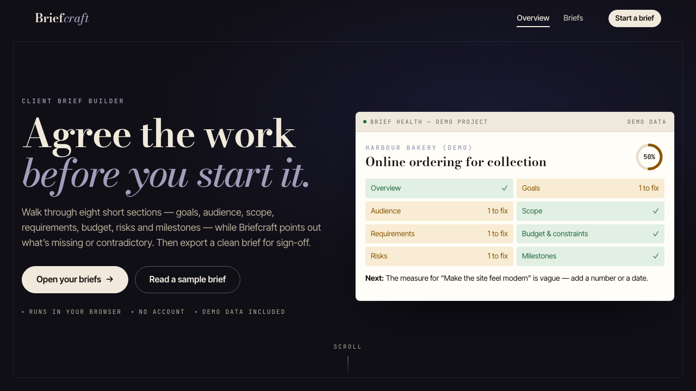
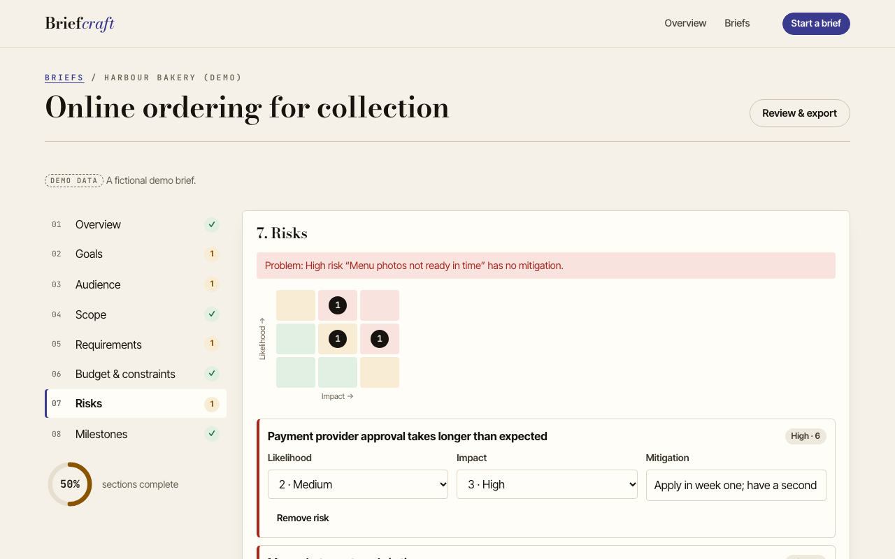
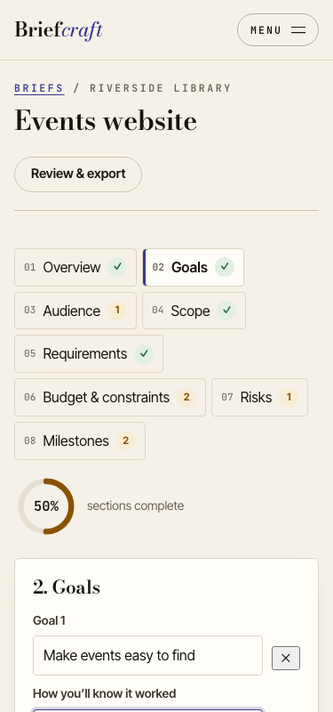

# Briefcraft

A client brief builder: eight short sections — overview, goals, audience, scope, requirements, budget and constraints, risks, milestones — with a gap checker that flags what’s missing or contradictory, then a clean brief to print or export as Markdown for sign-off.

**Live demo:** [https://briefcraft-app.vercel.app/](https://briefcraft-app.vercel.app/) — runs entirely in your browser; demo data is fictional and labelled.



| Risks step | Mobile |
| --- | --- |
|  |  |

## Run it

```bash
npm install
npm run dev        # http://localhost:5218
npm test
npm run build
npm run test:e2e   # Playwright smoke test (npm run e2e:install once if Chromium is missing)
```

## Main workflow

1. The app opens with two labelled, fictional **briefs**: one nearly finished with a few deliberate problems, one barely started. **Briefs → Clear demo briefs** removes them.
2. **New brief** → client, project and a starting template (website redesign, brand identity, mobile app MVP or blank).
3. Work through the **sections**. The side list shows how many issues each section has; the current section lists them in plain language. Goals take a success measure, requirements are sorted into must / should / could / won’t, risks get likelihood × impact on a 3 × 3 matrix with a mitigation, milestones are kept in date order.
4. **Review & export** → every remaining issue linked to its section, the formatted brief, **Copy Markdown**, **Download .md** and **Print** (navigation hidden in print).

## Rules

- Gaps: missing client/project, under 15 words of background, goals without measures, audiences without needs, empty in- or out-of-scope lists, no must-haves, no budget, no deadline, no risks, no milestones, no approver.
- Problems: vague measures with no number, items both in and out of scope, over 60% must-haves (with 4+ requirements), budget minimum above maximum, past deadlines, high risks (score ≥ 6) without mitigation, milestones after the deadline.
- Completeness = share of the eight sections with no issues.

## Design

Shared editorial system: Bodoni Moda display type, Inter Tight interface text, a completeness ring, issues coloured amber (gap) and red (problem), a MoSCoW board, an ink hero whose preview is the real section checklist, and a warm paper workspace. Motion is disabled under `prefers-reduced-motion`.

## Tests

- `src/lib/brief.test.ts` — a clean brief, gaps in every section, each contradiction, over-prioritisation, risk scoring, budget and time labels, Markdown output.
- `src/App.test.tsx` — completeness on the list, issues clearing as you fix them, creating from a template and stepping on, adding scope, the review page.
- `e2e/smoke.spec.ts` — landing, create a brief and fill sections with reload persistence, risk matrix, Markdown download, plus 375px layout checks.

## Limitations

- One author, one browser; no comments or shared editing.
- The gap checker uses simple rules — it can’t judge whether a goal is the right goal.

## Future improvements

- Version history and a client-facing read-only link.

## Licence

MIT — see [LICENSE](LICENSE).
